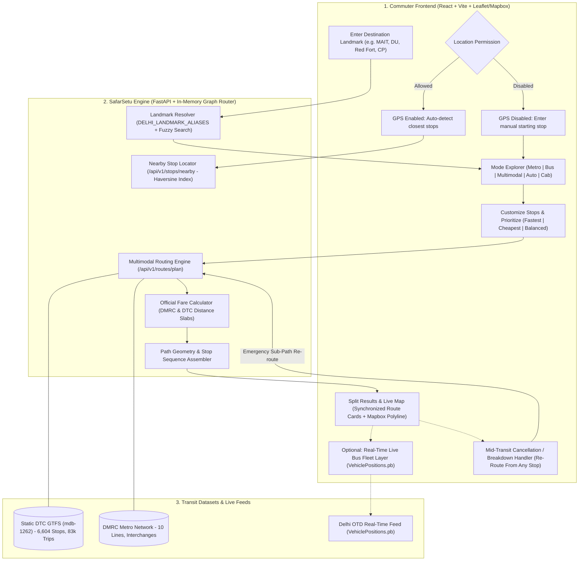

# SafarSetu — Multimodal Transit Assistant for Delhi/NCR

**Stage 1 & Stage 2A: Static Transit Routing Engine & Delhi OTD Real-Time Vehicle Positions**

SafarSetu is a high-performance public transport routing engine designed for Delhi/NCR commuters and tourists. It operates strictly on genuine, verified Delhi transit data without synthetic or invented fallback records.

---

## 1. Directory Structure

```
backend/
├── app/
│   ├── api/
│   │   └── v1/
│   │       ├── endpoints/
│   │       │   ├── health.py             # System & dataset health (/api/v1/health)
│   │       │   ├── stops.py              # Real stop search & nearby query (/api/v1/stops)
│   │       │   ├── routes.py             # Route planning & comparison (/api/v1/routes)
│   │       │   ├── realtime.py           # Live vehicle positions (/api/v1/realtime)
│   │       │   └── trips.py              # Sample domain endpoints
│   │       └── api.py                    # V1 router aggregation
│   ├── core/
│   │   └── config.py                     # Typesafe configuration via pydantic-settings
│   ├── models/
│   │   ├── transit.py                    # Normalized GTFS models (24:00+ times, calendar, stops)
│   │   ├── journey.py                    # Multimodal journey and leg models
│   │   └── realtime.py                   # Real-time vehicle positions and feed status models
│   ├── schemas/
│   │   ├── routing.py                    # Routing and health validation schemas
│   │   ├── realtime.py                   # Real-time vehicle positions & status schemas
│   │   └── trip.py                       # Trip schemas
│   ├── repositories/
│   │   ├── transit_repository.py         # In-memory spatial & relational transit index
│   │   └── realtime_repository.py        # Thread-safe bounded in-memory vehicle cache
│   ├── services/
│   │   ├── data_source_service.py        # Dataset lifecycle & context singleton
│   │   ├── data_validator.py             # Structural & coordinate validator
│   │   ├── gtfs_loader.py                # Normalized GTFS parser
│   │   ├── graph_builder.py              # Multimodal timetable graph builder
│   │   ├── routing_engine.py             # Time-dependent transit router
│   │   ├── route_ranker.py               # Multi-objective route ranker
│   │   ├── realtime_feed_service.py      # GTFS-RT Protobuf parser & static GTFS matcher
│   │   └── realtime_poller.py            # Async background poller with backoff & key masking
│   ├── utils/
│   │   └── geo.py                        # Haversine distance & NCR boundary verification
│   └── main.py                           # FastAPI application entrypoint & lifespan
├── data/
│   ├── raw/
│   │   └── mdb-1262/                     # Extracted genuine Delhi DTC GTFS archive
│   └── metadata/                         # Checksums and download metadata
├── docs/
│   ├── data_sources.md                   # Real transit data assessment & provenance log
│   └── architecture.md                   # Routing engine & real-time architecture specification
├── scripts/
│   ├── validate_gtfs.py                  # CLI GTFS validation & reporting tool
│   ├── ingest_gtfs.py                    # CLI ingestion & graph construction tool
│   └── download_delhi_gtfs.py            # Automated downloader for Mobility Database feed
├── tests/
│   ├── test_api.py                       # Base API tests
│   ├── test_api_v1.py                    # Endpoint contract & comparison tests
│   ├── test_validation.py                # Schema, FK, and coordinate validation tests
│   ├── test_routing_engine.py            # Timetable search, transfer, and fare tests
│   ├── test_integration_real_data.py    # Integration tests using genuine Delhi dataset
│   └── test_realtime.py                  # GTFS-RT protobuf, static matching, and poller tests
├── requirements.txt                      # Dependencies
├── run.py                                # Application server runner
└── README.md
```

---

## 2. End-to-End System Workflow



---

## 3. Transit Data Provenance & Real-Time Feed

1. **Static GTFS Data (`mdb-1262`)**:
   - Provider: Delhi Transport Corporation (DTC) / DIMTS Bus Network.
   - Scale: 6,342 real Delhi stops, 2,964 routes, 78,515 trips, 3,276,092 scheduled stop times.
   - Service Dates: 2022-01-01 to 2024-01-01 (flagged as historical schedule).
2. **Delhi OTD Real-Time Feed (`VehiclePositions.pb`)**:
   - Provider: Department of Transport, GNCTD / IIIT-Delhi Open Transit Data portal.
   - Endpoint: `https://otd.delhi.gov.in/api/realtime/VehiclePositions.pb?key=YOUR_PRIVATE_KEY`
   - Serialization: GTFS-Realtime Protocol Buffers (Specification 2.0).
   - Truthful Handling: Vehicles matching static schedules display verified route names and scheduled next stops. Unassociated vehicles are preserved and labeled as `unassociated` without fabricating routes or ETAs.

---

## 4. Configuration & Credentials

Set up your `.env` file (configured via `.env.example`):

```bash
# Static GTFS Settings
GTFS_DATA_DIR="data/raw/mdb-1262"
DEFAULT_SOURCE_ID="mdb-1262"
MAX_LOADED_TRIPS=5000
WALK_TRANSFER_MAX_METERS=300.0

# Delhi OTD Real-Time Settings
# Register at https://otd.delhi.gov.in/data/realtime/ to obtain an authorized private key
OTD_REALTIME_ENABLED=true
OTD_REALTIME_URL="https://otd.delhi.gov.in/api/realtime/VehiclePositions.pb"
OTD_REALTIME_API_KEY="YOUR_PRIVATE_KEY_HERE"
OTD_REALTIME_POLL_INTERVAL_SECONDS=15
OTD_REALTIME_REQUEST_TIMEOUT_SECONDS=10.0
OTD_REALTIME_MAX_CACHE_SIZE=10000
OTD_REALTIME_STALE_THRESHOLD_SECONDS=300
```

> **Security Note:** The API key is never printed, logged, or returned in HTTP responses. All logs mask sensitive query parameters automatically.

---

## 5. Running the Pipeline & Server

### Step 1: Run Full Automated Test Suite
```bash
pytest -v
```

### Step 2: Validate Ingested GTFS Dataset
```bash
python scripts/validate_gtfs.py --dir data/raw/mdb-1262 --source mdb-1262
```

### Step 3: Start the FastAPI Server
```bash
python run.py
```
*Or with Uvicorn CLI directly:*
```bash
uvicorn app.main:app --reload --host 0.0.0.0 --port 8000
```

---

## 6. Key Endpoints

- **Interactive Swagger Documentation:** [http://127.0.0.1:8000/docs](http://127.0.0.1:8000/docs)
- **System & Real-Time Health:** `GET /health` or `GET /api/v1/health`
- **Real-Time Polling Status:** `GET /api/v1/realtime/status`
- **Live Vehicle Positions:** `GET /api/v1/realtime/vehicles?limit=50`
  - Supports filters: `route_id`, `trip_id`, `is_matched`, bounding box `min_lat`, `max_lat`, `min_lon`, `max_lon`.
- **Search Genuine Stops:** `GET /api/v1/stops/?query=Narela&page=1&page_size=10`
- **Find Nearby Stops:** `GET /api/v1/stops/nearby?lat=28.6315&lon=77.2167&radius_meters=1000`
- **Plan Multimodal Route:** `POST /api/v1/routes/plan`
- **Compare Route Candidates:** `POST /api/v1/routes/compare`
